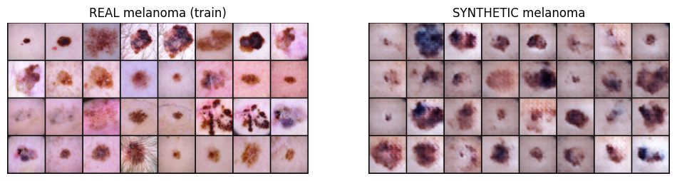
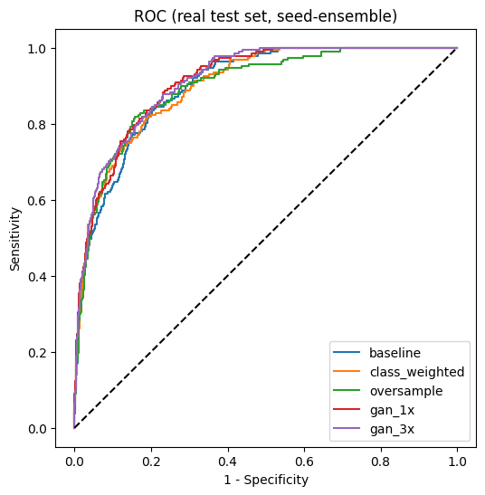
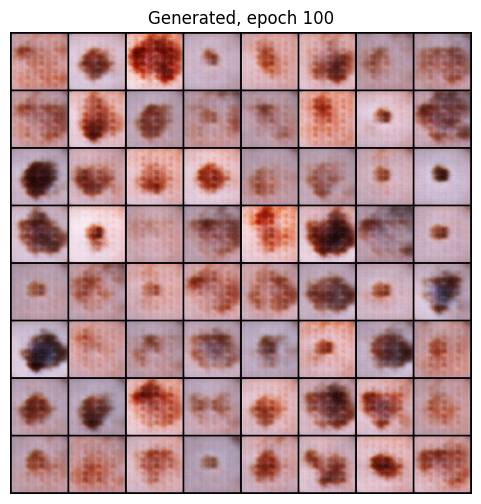
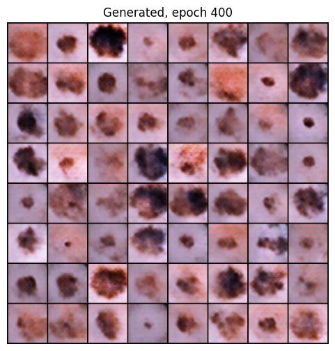
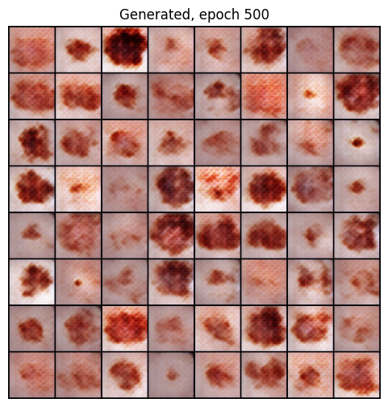
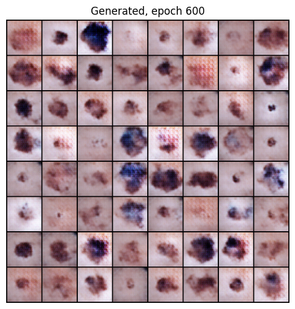

# GAN-based Augmentation for Imbalanced Melanoma Classification (HAM10000)

**Does adding GAN-generated melanoma images help a classifier detect melanoma better than simpler ways of handling class imbalance?**

This is a small, controlled study on HAM10000. A DCGAN is trained on the minority class (melanoma) and its synthetic images are added to the training set. The result is compared against no imbalance handling, class-weighted loss and minority oversampling, using lesion-level splits and evaluation on real test images only.

**Short answer:** GAN augmentation gave a small AUROC gain (0.883 to about 0.898) that was consistent across classifier seeds, but it did **not** give a clear gain in sensitivity at 90% specificity, and the evidence comes from a single GAN run. Details and caveats are below.

---

## 1. Problem

Medical image datasets are small and imbalanced. In HAM10000, melanoma is only about 11% of the images (1,113 of 10,015). A model that predicts "not melanoma" for everything would be about 89% accurate and clinically useless, and missing a melanoma (a false negative) is the costly error. Because of this:

- **Accuracy is not reported as a main metric.** The main metrics are **AUROC** and **sensitivity at a fixed specificity (90%)**.
- The question is whether *synthetic* minority-class images add useful information, or whether simpler fixes (class weights, oversampling) work just as well.

## 2. Approach

1. **Leakage-free split.** HAM10000 has several images per lesion (7,470 unique lesions for 10,015 images). A random image-level split would put photos of the same lesion in train and test. The split is therefore **grouped by `lesion_id`** (`StratifiedGroupKFold`), and the notebook asserts that no lesion appears in two splits.
2. **GAN trained on train-set melanoma only.** A DCGAN (spectral-norm discriminator, label smoothing, flip augmentation for the discriminator) is trained on the 767 melanoma images of the training split. Validation and test images are never seen by the GAN.
3. **Five training setups**, same classifier and same hyper-parameters:

| Method | Description |
|---|---|
| `baseline` | Standard training, no imbalance handling |
| `class_weighted` | BCE loss with `pos_weight = n_neg / n_pos` |
| `oversample` | Melanoma / non-melanoma sampled 50/50 (real duplicates) |
| `gan_1x` | Training set + synthetic melanoma images equal to the real melanoma count (+767) |
| `gan_3x` | Training set + 3x synthetic melanoma images (+2,301) |

4. **Evaluation on real images only.** Synthetic images are added to the training set only. Validation and test sets contain real images only. The operating threshold for "sensitivity at 90% specificity" is chosen on the **validation** set, never on the test set, and the best epoch is selected by validation AUROC.

## 3. Setup

| Item | Setting |
|---|---|
| Data | HAM10000, binary task: melanoma (1) vs all other lesion types (0) |
| Split | Grouped by `lesion_id`, stratified: train 6,966 / val 1,374 / test 1,675 images |
| Melanoma per split | train 767 (11.0%), val 159 (11.6%), test 187 (11.2%) |
| Preprocessing | Center crop, resize to 64x64; classifier input upsampled to 128x128 |
| Classifier | ImageNet-pretrained ResNet18, AdamW (lr 1e-4), batch 64, 12 epochs, flips/rotations/brightness augmentation (same for all methods) |
| GAN | DCGAN, 600 epochs, batch size 64 (about 7,200 iterations), Adam (lr 2e-4, betas 0.5/0.999), trained once (seed 0) |
| Seeds | 3 classifier seeds (0, 1, 2) per method; mean and std over seeds |
| Statistics | Bootstrap (1,000 resamples) of the test set for AUROC differences, using seed-averaged predictions |

## 4. Results (real test set: 1,675 images, 187 melanoma)

Mean ± std over 3 classifier seeds.

| Method | AUROC | AUPRC | Sensitivity @ 90% specificity |
|---|---|---|---|
| Baseline | 0.883 ± 0.002 | 0.529 ± 0.048 | 0.610 ± 0.032 |
| Class-weighted | 0.885 ± 0.019 | 0.532 ± 0.046 | 0.651 ± 0.068 |
| Oversampling | 0.887 ± 0.007 | 0.545 ± 0.021 | 0.629 ± 0.069 |
| **+ GAN 1x** | **0.898 ± 0.007** | **0.586 ± 0.030** | 0.649 ± 0.025 |
| **+ GAN 3x** | 0.897 ± 0.008 | 0.569 ± 0.026 | 0.645 ± 0.029 |

Per-seed values are in [`results/results_raw.csv`](results/results_raw.csv).

### Bootstrap: AUROC difference (95% CI, test-set resampling)

| Comparison | Difference | 95% CI |
|---|---|---|
| GAN 1x − baseline | +0.013 | [+0.001, +0.024] |
| GAN 3x − baseline | +0.015 | [+0.003, +0.026] |
| Oversampling − baseline | −0.002 | [−0.017, +0.013] |
| Class-weighted − baseline | +0.002 | [−0.009, +0.014] |
| GAN 1x − oversampling | +0.014 | [+0.002, +0.029] |

### Figures

**Real vs synthetic melanoma (training images, final epoch-600 generator):**



**ROC curves on the real test set (seed-averaged):**



**Generator samples during training** (same fixed noise vectors). The style of the samples changed noticeably between epochs:

| Epoch 100 | Epoch 400 |
|---|---|
|  |  |

| Epoch 500 | Epoch 600 (used) |
|---|---|
|  |  |

## 5. Findings

- **AUROC:** both GAN variants are about +0.015 above the baseline (0.898 and 0.897 vs 0.883). All six GAN runs (0.888 to 0.904) are at or above all three baseline runs (0.881 to 0.884). The bootstrap CIs for GAN vs baseline exclude zero, but the lower bound for GAN 1x is only +0.001. Class weighting and oversampling were not distinguishable from the baseline.
- **Sensitivity at 90% specificity:** no clear difference. Baseline 0.610; all other methods 0.629 to 0.651, with seed standard deviations of 0.03 to 0.07. Class weighting (0.651) is as good as GAN 1x (0.649) on this metric.
- **Not compared:** sensitivity at a fixed 0.5 threshold is stored in the raw results but is not a fair comparison across methods. Class weighting and oversampling shift predicted probabilities toward melanoma, which raises sensitivity at 0.5 without improving ranking.
- **Synthetic image quality is limited.** The generator reproduced coarse lesion shape and skin tone, but samples were blurrier than real images, showed more saturated blue/purple hues, and lacked fine dermoscopic detail (hair, sharp borders, texture). GAN style also drifted between epochs 400, 500 and 600 (see figures), i.e. training was not stable.

**Interpretation.** The data support a *small, consistent AUROC improvement* from adding synthetic melanoma images in this setup. They do **not** show that the synthetic images carry clinically useful melanoma-specific information, and they do not show a sensitivity benefit. Because the synthetic images are visibly imperfect, the gain may partly come from other effects such as extra training steps or regularization (see limitations).

## 6. Limitations

- **One GAN run.** Classifier seeds vary (3), but the GAN was trained once (seed 0). "GAN helps" rests on a single generator, and the GAN itself was unstable across epochs.
- **No checkpoint selection.** Only the final epoch-600 generator was used. Intermediate epochs were not saved, so the effect of GAN training length was not tested.
- **Training steps are not matched.** Classifier epochs are fixed at 12, so GAN variants take more gradient steps (about +11% for 1x and +33% for 3x). A baseline trained for the same number of steps was not run, so the gain could partly reflect more training or regularization rather than melanoma-specific information.
- **Wide uncertainty on a small test set.** The test set has 187 melanoma cases, and the 1x GAN CI barely excludes zero. The bootstrap only reflects test-set sampling, not variation from GAN training or splits. Only one train/val/test split was used.
- **Low resolution.** Images are 64x64 (upsampled to 128x128 for the classifier), which discards dermoscopic detail relevant to melanoma.
- **No image-quality or memorization checks.** No FID or nearest-neighbor test was run, and no dermatologist review of synthetic images.
- **Binary task, unconditional GAN.** The GAN was trained only on melanoma images, so it is effectively class-specific rather than a multi-class conditional GAN.
- **Single dataset.** HAM10000 comes mostly from a limited patient population; no external validation. This is a research exercise, not a clinical tool.

## 7. Future work

- Grad-CAM comparison of baseline and GAN-augmented models, to check whether models rely on synthetic artifacts (e.g. the blue/purple hues).
- Step-matched baseline control, multiple GAN seeds, and saved checkpoints for a training-length ablation.
- FID and nearest-neighbor memorization checks; higher-resolution or conditional generative models.
- Extension to other imbalanced medical imaging data such as retinal images.

## 8. Reproduce

1. Open `GAN_Melanoma_Augmentation.ipynb` in Google Colab with a **T4 GPU** runtime.
2. Run the cells in order. The dataset is downloaded with `kagglehub` (`kmader/skin-cancer-mnist-ham10000`).
3. The notebook includes saved outputs from the original run. It contains one leftover setup cell for an earlier batch-16 GAN configuration; the GAN that was actually used is the 600-epoch, batch-64 cell that follows it.

```
.
├── README.md
├── GAN_Melanoma_Augmentation.ipynb   # full pipeline with saved outputs
└── results/
    ├── results_raw.csv               # per-seed metrics
    ├── real_vs_synthetic.png
    ├── roc_curves.png
    └── gan_samples_ep{100,400,500,600}.png
```

## References

- Tschandl P. et al. *The HAM10000 dataset, a large collection of multi-source dermatoscopic images of common pigmented skin lesions.* Scientific Data, 2018.
- Radford A. et al. *Unsupervised Representation Learning with Deep Convolutional GANs (DCGAN).* ICLR, 2016.
- Miyato T. et al. *Spectral Normalization for GANs.* ICLR, 2018.
